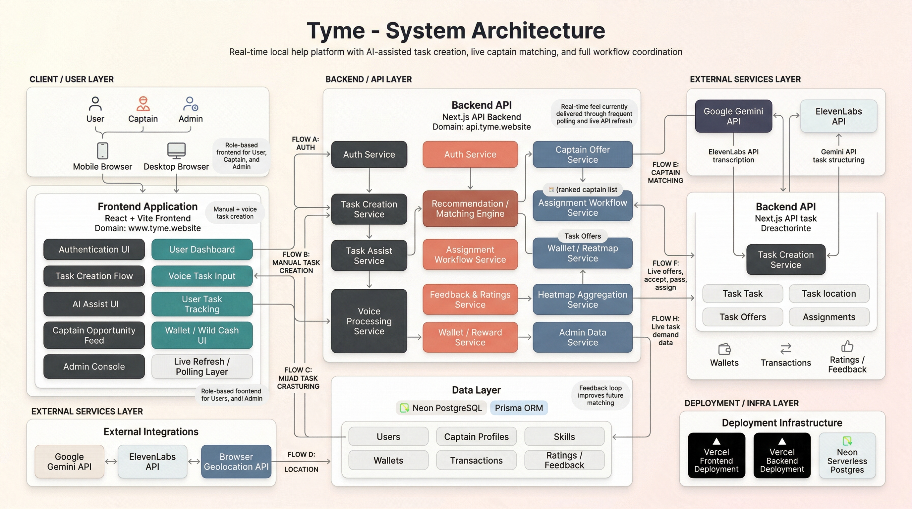
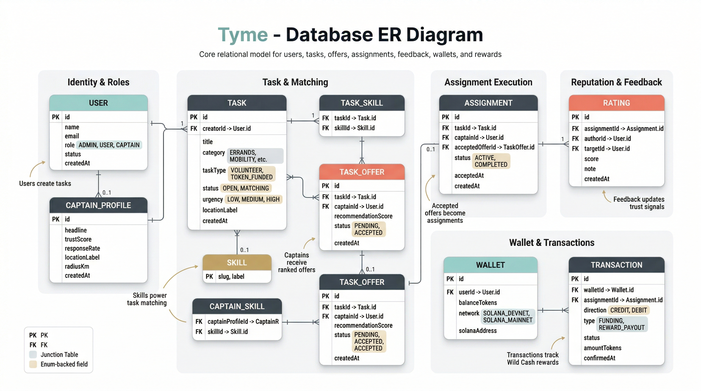
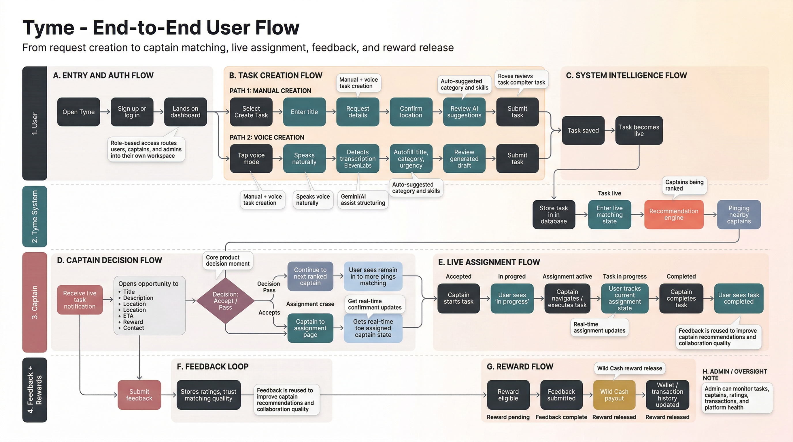

# Tyme

**Real-time local task dispatch. Users post jobs. Captains take them. Everything moves fast.**

Tyme is a hyperlocal task marketplace that connects people who need everyday help with nearby captains who can provide it. Tasks flow through a structured lifecycle: creation, AI structuring, captain matching, acceptance, execution, feedback, and reward release, with live status updates at every step.

Built as a full-stack hackathon MVP with a real deployed product, working role-based flows, voice input, AI task structuring, and a captain dispatch engine.

---

## Live

| Surface | URL |
| --- | --- |
| App | [www.tyme.website](https://www.tyme.website) |
| Login | [www.tyme.website/login](https://www.tyme.website/login) |
| Backend API | [api.tyme.website](https://api.tyme.website) |
| Repository | [github.com/Aryan9Dwivedi/WildHack26](https://github.com/Aryan9Dwivedi/WildHack26) |

---

## What It Does

Three roles. One workflow.

| Role | Responsibilities |
| --- | --- |
| **User** | Creates tasks, monitors matching progress, tracks assignment state, submits feedback |
| **Captain** | Receives ranked nearby opportunities, accepts or passes tasks, executes assignments, earns Wild Cash |
| **Admin** | Monitors platform activity, captain health, wallet transactions, and operational signals |

### Core Capabilities

- **Task creation**: manual entry or voice-to-text via browser `MediaRecorder`
- **AI task structuring**: Gemini parses raw input into category, urgency, required skills, and a cleaner structured task draft
- **Captain matching**: a recommendation engine ranks nearby captains against task requirements and pushes offers
- **Live dispatch loop**: fast polling delivers real-time-feeling state updates without requiring WebSockets
- **Two-sided feedback**: both user and captain submit ratings after completion
- **Wild Cash wallet**: demo-funded wallet with full transaction history and reward payout tracking
- **Demand heatmap**: Leaflet-powered captain heatmap view showing task density by location

---

## Product Workflow

```text
User creates task (voice or manual)
        |
        v
AI structures task -> category, skills, urgency inferred
        |
        v
Recommendation engine ranks nearby captains -> TaskOffers created
        |
        v
Captain sees live opportunity feed -> accepts or passes
        |
        v
Task becomes Assignment -> Captain starts and completes
        |
        v
Both sides submit feedback
        |
        v
Wild Cash reward released -> wallet and transaction records updated
```

---

## Architecture

Tyme is a monorepo split into two Vercel deployments:

```text
WildHack26/
|-- frontend/               React + Vite product UI         -> www.tyme.website
|-- prisma/                 Schema, migrations, seed data
|-- src/                    Next.js backend + API handlers  -> api.tyme.website
|   |-- app/                Route handlers (Next.js App Router)
|   `-- server/
|       |-- auth/           Session management, JOSE JWTs, bcrypt
|       |-- db/             Prisma client singleton
|       |-- http/           CORS helpers
|       `-- services/       Core business logic (tasks, matching, AI, heatmap, wallet)
|-- scripts/
`-- public/
```

### System Architecture Diagram



### Frontend (`frontend/`)

```text
src/
|-- components/             Shared UI components, captain-specific widgets
|-- lib/                    Auth helpers, API client, utility functions
`-- pages/                  Route-level page components
    |-- captain/            Opportunity feed, assignment workflow
    |-- admin/              Platform monitoring
    `-- auth + user flows   Login, signup, task creation, tracking, feedback
```

### Backend (`src/`)

API route groups under `src/app/`:

| Group | Endpoints |
| --- | --- |
| `auth` | `login`, `signup`, `me` |
| `tasks` | `create`, `update`, `detail`, `feedback`, `assist`, `voice-assist` |
| `captain` | `opportunities`, `assignments`, `accept`, `decline`, `availability`, `heatmap` |
| `dashboards` | `user`, `captain` |
| `wallet` | balance, funding, transactions |
| `health` | API health check |

---

## Tech Stack

### Frontend

| Layer | Tech |
| --- | --- |
| Framework | React + Vite |
| Routing | React Router |
| Data fetching | TanStack React Query |
| Styling | Tailwind CSS + Radix UI |
| Animation | Framer Motion |
| Icons | Lucide React |
| Maps | React Leaflet + Leaflet Heat |

### Backend

| Layer | Tech |
| --- | --- |
| Framework | Next.js App Router |
| Language | TypeScript |
| ORM | Prisma |
| Auth | JOSE (JWT) + bcryptjs |
| Runtime | Node.js 22.x |

### Data & Infrastructure

| Layer | Tech |
| --- | --- |
| Database | PostgreSQL (Neon Serverless) |
| Backend deploy | Vercel |
| Frontend deploy | Vercel |

### AI & Voice

| Capability | Provider |
| --- | --- |
| Task structuring, category and skill inference | Google Gemini API |
| Voice transcription pipeline | ElevenLabs API |
| Voice capture | Browser MediaRecorder API |
| Location | Browser Geolocation API |

---

## Database Model

Core entities and their roles:

| Model | Purpose |
| --- | --- |
| `User` | Platform user accounts |
| `CaptainProfile` | Captain-specific data, availability, location |
| `Skill` | Skill taxonomy |
| `CaptainSkill` | Captain <-> Skill join |
| `Task` | Task records with status, location, and category |
| `TaskSkill` | Task <-> required Skill join |
| `TaskOffer` | Per-captain offer from the matching engine |
| `Assignment` | Active task <-> captain binding with lifecycle state |
| `Rating` | Two-sided feedback after completion |
| `Wallet` | Per-user balance tracking |
| `Transaction` | Full transaction ledger for funding and rewards |

### Database ER Diagram



### State Machines

**Task status:** `DRAFT` -> `OPEN` -> `MATCHING` -> `OFFERED` -> `ASSIGNED` -> `IN_PROGRESS` -> `COMPLETED`

**Assignment status:** `PENDING_START` -> `ACTIVE` -> `COMPLETED`

**TaskOffer status:** `PENDING` -> `ACCEPTED` | `DECLINED` | `EXPIRED` | `WITHDRAWN`

---

## Matching Engine

The recommendation engine lives in `src/server/services/` and is responsible for:

1. Scoring and ranking available captains against an incoming task using location proximity, skill overlap, and availability.
2. Creating `TaskOffer` records for top-ranked captains.
3. Rolling offers forward when a captain passes or an offer expires.
4. Feeding assignment state back to the user dashboard through polling.

The system intentionally uses **fast polling** over WebSockets. Under hackathon constraints this was the right tradeoff: no socket infrastructure to manage, easy deployment on Vercel, and a live-enough UX at a 2 to 5 second refresh interval.

---

## AI Task Structuring

When a user submits raw task input, typed or transcribed, the backend calls the Gemini API with a structured prompt that extracts:

- **Category**: what kind of task this is
- **Urgency**: inferred priority level
- **Required skills**: matched against the platform skill taxonomy
- **Cleaned task draft**: a more consistent structured version of the request

This reduces friction for users and improves matching quality by ensuring tasks have consistent metadata rather than only freeform text.

---

## Voice Input Pipeline

1. The browser captures audio through the `MediaRecorder` API.
2. The audio blob is sent to `/api/tasks/voice-assist`.
3. The backend calls the ElevenLabs transcription API.
4. The transcript is passed through the Gemini structuring pipeline.
5. Structured fields are returned to the frontend for user review before saving.

### End-to-End User Flow Diagram



---

## Local Development

### Prerequisites

- Node.js `22.x`
- npm
- a [Neon](https://neon.tech) PostgreSQL database

### Install

```bash
npm install
npm run frontend:install
```

### Environment Variables

**Backend** - create `.env` at the repo root:

```env
DATABASE_URL=           # Neon pooled connection string
DIRECT_URL=             # Neon direct connection (optional, for local Prisma tooling)
AUTH_SECRET=            # Random secret for JWT signing
CORS_ALLOW_ORIGIN=      # Frontend origin, e.g. http://127.0.0.1:4173
GEMINI_API_KEY=
GEMINI_MODEL=           # e.g. gemini-2.0-flash
ELEVENLABS_API_KEY=
ELEVENLABS_SPEECH_MODEL=
```

**Frontend** - create `frontend/.env`:

```env
VITE_API_BASE_URL=http://127.0.0.1:3000
```

See `.env.example` and `frontend/.env.example` for reference values.

### Database Setup

```bash
npm run db:generate
npm run db:apply
npm run db:seed
```

### Run

```bash
# Terminal 1 - backend
npm run dev

# Terminal 2 - frontend
npm run frontend:dev
```

| Service | Local URL |
| --- | --- |
| Backend API | `http://127.0.0.1:3000` |
| Frontend | `http://127.0.0.1:4173` |

---

## Deployment

Two Vercel projects, one repository.

### Backend project

| Setting | Value |
| --- | --- |
| Root directory | `/` |
| Domain | `api.tyme.website` |

Required env vars: `DATABASE_URL`, `AUTH_SECRET`, `CORS_ALLOW_ORIGIN`, `GEMINI_API_KEY`, `ELEVENLABS_API_KEY`

### Frontend project

| Setting | Value |
| --- | --- |
| Root directory | `frontend/` |
| Domain | `www.tyme.website` |

Required env var: `VITE_API_BASE_URL=https://api.tyme.website`

---

## Quality Checks

```bash
npm run check
npm run build
npm run frontend:check
npm run frontend:build
npm run build:all
```

---

## Scope and Tradeoffs

This is an optimized hackathon MVP. What is real:

- full role-based product flows
- deployed frontend and backend
- voice + AI-assisted task creation
- captain dispatch and offer rolling
- assignment lifecycle
- two-sided feedback and rating system
- Wild Cash wallet with transaction ledger

What is intentionally demo-oriented:

- **Wallet funding** includes a demo top-up flow instead of a real payment processor
- **Real-time updates** use polling instead of WebSockets
- **Trust and safety**, KYC, and dispute resolution are out of scope for this release
- **Production auth hardening** like token rotation and device/session management would be the next layer

---

## License

This repository is currently shared as a hackathon project codebase. Add a formal license before open-sourcing or commercializing it further.
